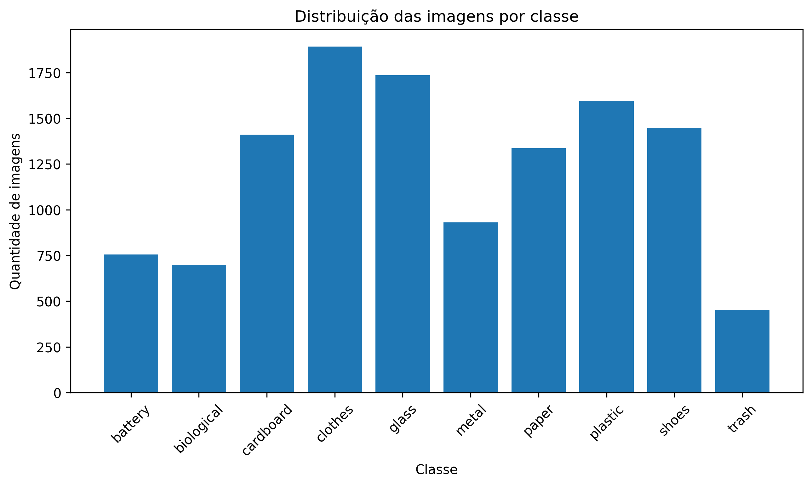
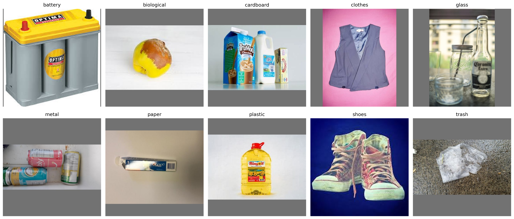
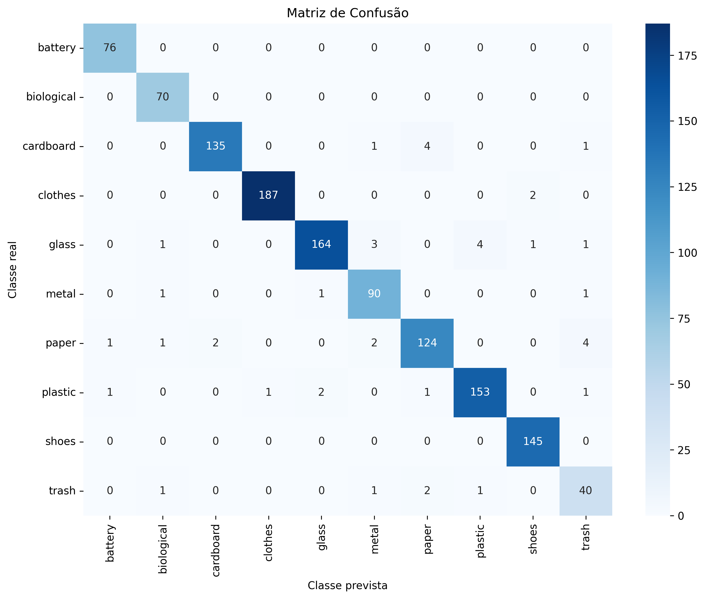

# Classificação de Resíduos Sólidos utilizando Visão Computacional e Aprendizado de Máquina

**Trabalho de Conclusão de Curso (TCC) — Engenharia de Software | Universidade Tecnológica Federal do Paraná (UTFPR)**

Projeto de classificação automática de resíduos sólidos por meio de imagens, utilizando técnicas de visão computacional e aprendizado profundo (*Deep Learning*).

A solução contempla o treinamento e a avaliação de redes neurais convolucionais, o desenvolvimento de uma API com **Python e FastAPI** e uma aplicação web construída com **React**, permitindo integrar os modelos de inteligência artificial a uma interface de utilização.

---

## Sobre o projeto

A classificação e a separação adequadas de resíduos sólidos são etapas importantes para a reciclagem e a destinação correta dos materiais. Entretanto, a identificação de diferentes categorias de resíduos pode representar um desafio, especialmente diante da diversidade de características visuais dos objetos.

Este projeto investiga a aplicação de técnicas de aprendizado profundo para identificar automaticamente diferentes categorias de resíduos a partir de imagens.

Foram utilizadas duas arquiteturas de redes neurais convolucionais:

- **EfficientNetV2S**
- **ResNet50**

Os modelos foram treinados e avaliados utilizando imagens distribuídas em dez categorias. A arquitetura EfficientNetV2S apresentou o melhor desempenho geral nos experimentos, alcançando **96,57% de acurácia no conjunto de teste**.

Além dos experimentos de aprendizado de máquina, foi desenvolvida uma aplicação web que integra uma interface React a uma API FastAPI responsável pela comunicação com o modelo treinado.

## Objetivos

### Objetivo geral

Desenvolver uma solução computacional para a classificação de resíduos sólidos a partir de imagens, utilizando técnicas de visão computacional e aprendizado de máquina.

### Objetivos específicos

- Preparar e organizar um conjunto de dados de imagens de resíduos sólidos.
- Aplicar técnicas de pré-processamento e padronização das imagens.
- Investigar arquiteturas de redes neurais convolucionais.
- Utilizar técnicas de *transfer learning* e *fine-tuning*.
- Treinar e avaliar os modelos EfficientNetV2S e ResNet50.
- Comparar os resultados por meio de métricas de classificação.
- Desenvolver uma API para disponibilizar o modelo treinado.
- Construir uma interface web para interação com a solução.

---

## Tecnologias utilizadas

| Categoria | Tecnologias |
|---|---|
| Linguagem de programação | Python, JavaScript |
| Aprendizado profundo | TensorFlow, Keras |
| Modelos de classificação | EfficientNetV2S, ResNet50 |
| Ambiente de treinamento | Google Colab |
| Backend | FastAPI |
| Frontend | React |
| Ferramenta de desenvolvimento frontend | Vite |
| Estilização | Tailwind CSS |
| Controle de versão | Git, GitHub |

---

## Arquitetura da solução

A solução é organizada em três componentes principais: treinamento dos modelos, backend e frontend.

```text
                  DATASET DE IMAGENS
                          |
                          v
                  PRÉ-PROCESSAMENTO
                          |
                          v
                  TREINAMENTO DA IA
                          |
              +-----------+-----------+
              |                       |
              v                       v
        EfficientNetV2S            ResNet50
              |                       |
              +-----------+-----------+
                          |
                          v
                 AVALIAÇÃO DOS MODELOS
                          |
                          v
                  MODELO SELECIONADO
                          |
                          v
                    API FASTAPI
                          ^
                          |
                    FRONTEND REACT
                          ^
                          |
                        USUÁRIO
```

### Treinamento da inteligência artificial

Responsável pela preparação dos dados, treinamento das redes neurais e avaliação dos resultados experimentais.

### Backend

Desenvolvido em Python com FastAPI, responsável pela integração do modelo de classificação com a aplicação web.

### Frontend

Desenvolvido em React, responsável pela interface de interação com o sistema e comunicação com a API.

---

## Dataset

O conjunto de dados utilizado nos experimentos contém imagens de resíduos sólidos organizadas em dez categorias.

### Distribuição das imagens

| Classe | Descrição | Quantidade |
|---|---|---:|
| `battery` | Baterias | 756 |
| `biological` | Resíduos biológicos | 699 |
| `cardboard` | Papelão | 1.411 |
| `clothes` | Roupas | 1.892 |
| `glass` | Vidro | 1.736 |
| `metal` | Metal | 930 |
| `paper` | Papel | 1.336 |
| `plastic` | Plástico | 1.597 |
| `shoes` | Calçados | 1.449 |
| `trash` | Outros resíduos | 453 |
| **Total** | | **12.259** |

Os dados apresentam uma distribuição desigual entre as categorias, sendo `clothes` a classe com maior quantidade de imagens e `trash` a classe com menor representação.

### Distribuição por classe



A distribuição desigual deve ser considerada durante a avaliação dos modelos, pois a acurácia global não representa necessariamente o desempenho individual em todas as categorias.

### Exemplos das imagens



As imagens representam diferentes objetos, materiais e características visuais, proporcionando um conjunto de dados diversificado para a tarefa de classificação.

---

## Pré-processamento dos dados

A etapa de preparação dos dados tem como finalidade padronizar as imagens para sua utilização nos modelos de aprendizado profundo.

Entre as configurações documentadas nos experimentos estão:

| Parâmetro | Configuração |
|---|---|
| Resolução das imagens | 384 × 384 pixels |
| Batch size | 32 |
| Seed | 42 |
| Quantidade de classes | 10 |
| Framework | TensorFlow/Keras |

Os notebooks de treinamento documentam os procedimentos de preparação das imagens e as configurações utilizadas nos experimentos.

---

## Treinamento dos modelos

Foram realizados experimentos utilizando as arquiteturas EfficientNetV2S e ResNet50, aplicando técnicas de *transfer learning* e *fine-tuning*.

### Transfer Learning

O *transfer learning*, ou aprendizado por transferência, consiste em aproveitar o conhecimento adquirido por uma rede neural previamente treinada em outra tarefa.

Essa abordagem permite reutilizar representações visuais aprendidas anteriormente, adaptando o modelo ao problema de classificação de resíduos.

### Fine-tuning

O *fine-tuning* consiste em ajustar os pesos de determinadas camadas de uma rede neural pré-treinada para melhorar sua adaptação ao novo conjunto de dados.

No projeto, essa etapa foi utilizada para aprimorar o desempenho dos modelos após o treinamento inicial.

### EfficientNetV2S

A EfficientNetV2S é uma arquitetura de rede neural convolucional desenvolvida para oferecer uma relação eficiente entre desempenho e custo computacional.

Ela foi utilizada nos experimentos de classificação de resíduos, apresentando os melhores resultados gerais entre as arquiteturas avaliadas.

**Resultados principais:**

- Acurácia no teste: **96,57%**
- F1-score macro: **95,83%**
- F1-score ponderado: **96,58%**

### ResNet50

A ResNet50 é uma arquitetura de rede neural convolucional que utiliza conexões residuais para facilitar o treinamento de redes profundas.

Sua utilização permitiu comparar o desempenho de uma arquitetura consolidada com os resultados obtidos pela EfficientNetV2S.

**Resultados principais:**

- Acurácia no teste: **93,72%**
- F1-score macro: **93,54%**
- F1-score ponderado: **93,74%**

### Histórico dos treinamentos

Os arquivos de histórico dos experimentos registram as seguintes quantidades de épocas:

| Modelo | Transfer Learning | Fine-tuning |
|---|---:|---:|
| EfficientNetV2S | 20 | 15 |
| ResNet50 | 9 | 10 |

Os valores representam as épocas registradas nos históricos exportados, podendo diferir do número máximo de épocas configurado para cada experimento.

---

## Resultados experimentais

Os modelos foram avaliados em um conjunto de teste composto por **1.226 imagens**, distribuídas entre as dez categorias de resíduos.

### Comparação das métricas

| Métrica | EfficientNetV2S | ResNet50 |
|---|---:|---:|
| Acurácia | **96,57%** | 93,72% |
| Precisão macro | **95,38%** | 93,61% |
| Recall macro | **96,34%** | 93,67% |
| F1-score macro | **95,83%** | 93,54% |
| Precisão ponderada | **96,63%** | 93,91% |
| F1-score ponderado | **96,58%** | 93,74% |
| Classificações corretas | **1.184** | 1.149 |
| Total de imagens avaliadas | 1.226 | 1.226 |

A EfficientNetV2S apresentou desempenho superior à ResNet50 em todas as métricas globais apresentadas.

A diferença de acurácia entre as arquiteturas foi de aproximadamente **2,85 pontos percentuais**, representando 35 classificações corretas adicionais no conjunto de teste.

### Matrizes de confusão

As matrizes de confusão permitem visualizar os acertos e erros dos modelos em cada categoria.

Nas matrizes apresentadas, as linhas representam as classes reais e as colunas representam as classes previstas.

#### EfficientNetV2S



A EfficientNetV2S apresentou resultados expressivos em diversas categorias, incluindo:

- Baterias: 76 acertos em 76 imagens.
- Resíduos biológicos: 70 acertos em 70 imagens.
- Calçados: 145 acertos em 145 imagens.
- Plástico: 153 acertos em 159 imagens.
- Papelão: 135 acertos em 141 imagens.

#### ResNet50


A ResNet50 também apresentou desempenho elevado, embora tenha registrado mais erros de classificação em determinadas categorias.

Entre as confusões observadas, destacam-se imagens de papelão classificadas como papel e imagens de vidro classificadas como metal ou plástico.

### Desempenho por categoria

A tabela apresenta o recall de cada modelo nas dez categorias.

| Categoria | EfficientNetV2S | ResNet50 |
|---|---:|---:|
| Baterias | 100,00% | 100,00% |
| Biológicos | 100,00% | 98,57% |
| Papelão | 95,74% | 90,78% |
| Roupas | 98,94% | 98,41% |
| Vidro | 94,25% | 89,66% |
| Metal | 96,77% | 95,70% |
| Papel | 92,54% | 93,28% |
| Plástico | 96,23% | 89,31% |
| Calçados | 100,00% | 96,55% |
| Outros resíduos | 88,89% | 84,44% |

A EfficientNetV2S apresentou recall superior em oito das dez categorias e empatou com a ResNet50 na classificação de baterias.

A ResNet50 apresentou recall ligeiramente superior na categoria papel.

A classe `trash` apresentou o menor recall em ambos os modelos, sugerindo maior dificuldade de classificação nessa categoria.

### Discussão dos resultados

Os resultados demonstram que as duas arquiteturas são capazes de identificar diferentes categorias de resíduos com desempenho elevado no conjunto de teste utilizado.

Entretanto, a EfficientNetV2S apresentou maior capacidade de classificação geral nas condições experimentais avaliadas.

Os erros observados nas matrizes de confusão indicam dificuldades em algumas categorias que compartilham características visuais semelhantes.

Esses resultados reforçam a importância de avaliar os modelos não apenas pela acurácia, mas também por métricas individuais de cada classe.

---

## Aplicação web

O projeto inclui uma aplicação web desenvolvida para integrar os modelos de classificação a uma interface de utilização.

### Backend — FastAPI

O backend está localizado no diretório [`api_tcc`](./api_tcc).

A implementação utiliza Python e FastAPI, organizando os componentes da API em módulos responsáveis por configuração, carregamento do modelo, definição de esquemas e disponibilização das rotas.

Principais arquivos:

| Arquivo | Responsabilidade |
|---|---|
| `app/main.py` | Aplicação FastAPI e definição das rotas |
| `app/config.py` | Configurações da aplicação |
| `app/model_loader.py` | Carregamento do modelo de classificação |
| `app/schemas.py` | Definição dos esquemas de dados |
| `requirements.txt` | Dependências Python |

### Frontend — React

O frontend está localizado no diretório [`frontend`](./frontend).

A interface foi desenvolvida utilizando React, Vite e Tailwind CSS.

A estrutura inclui componentes reutilizáveis, páginas da aplicação, integração com a API e módulos auxiliares.

Principais diretórios e arquivos:

| Arquivo ou diretório | Responsabilidade |
|---|---|
| `src/App.jsx` | Estrutura principal da aplicação |
| `src/api.js` | Comunicação com a API |
| `src/components/` | Componentes reutilizáveis |
| `src/pages/` | Páginas da aplicação |
| `src/utils/` | Funções auxiliares |
| `src/index.css` | Estilos da interface |
| `package.json` | Dependências e scripts do frontend |

---

## Estrutura do repositório

```text
TCC_Treinamento_Garbage_Classification/
│
├── api_tcc/
│   ├── app/
│   │   ├── __init__.py
│   │   ├── config.py
│   │   ├── main.py
│   │   ├── model_loader.py
│   │   └── schemas.py
│   │
│   ├── requirements.txt
│   └── README.md
│
├── frontend/
│   ├── src/
│   │   ├── components/
│   │   ├── pages/
│   │   ├── utils/
│   │   ├── App.jsx
│   │   ├── api.js
│   │   ├── index.css
│   │   └── main.jsx
│   │
│   ├── index.html
│   ├── package.json
│   ├── package-lock.json
│   ├── vite.config.js
│   ├── tailwind.config.js
│   └── postcss.config.js
│
├── docs/
│   └── images/
│       ├── 01_distribuicao_classes.png
│       ├── 02_exemplos_classes.png
│       ├── 03_matriz_confusao.png
│       └── 04_matriz_confusao_resnet50.png
│
├── Treinamento_Garbage_Classification.ipynb
├── Treinamento_Garbage_Classification_ResNet50.ipynb
├── .gitignore
└── README.md
```

**Observação:** o diretório `docs/images/` corresponde à organização proposta para armazenar os gráficos e imagens dos experimentos.

---

## Instalação e execução

### Pré-requisitos

Para executar a aplicação localmente, são necessários:

- Python compatível com as dependências do backend.
- Node.js e npm.
- Git.
- Modelo treinado disponível no caminho configurado pela API.

### Clonar o repositório

```bash
git clone https://github.com/Roberto-Raposo/TCC_Treinamento_Garbage_Classification.git
cd TCC_Treinamento_Garbage_Classification
```

### Configurar o backend

Acesse o diretório da API:

```bash
cd api_tcc
```

Crie um ambiente virtual:

```bash
python -m venv .venv
```

Ative o ambiente virtual no Windows (PowerShell):

```powershell
.\.venv\Scripts\Activate.ps1
```

Em Linux ou macOS:

```bash
source .venv/bin/activate
```

Instale as dependências:

```bash
pip install -r requirements.txt
```

Configure o caminho do modelo treinado conforme as definições presentes em `app/config.py`.

O comando de inicialização da API deve ser confirmado no código e na documentação específica do backend, disponível em [`api_tcc/README.md`](./api_tcc/README.md).

### Configurar o frontend

Em outro terminal, acesse o diretório:

```bash
cd frontend
```

Instale as dependências:

```bash
npm install
```

Configure a comunicação com a API de acordo com as variáveis de ambiente e as configurações do projeto.

Os comandos disponíveis para inicializar e construir o frontend estão definidos nos scripts de `frontend/package.json`.

---

## Reproduzindo os experimentos

Os treinamentos foram desenvolvidos em notebooks Jupyter, utilizando o Google Colab.

Os arquivos estão disponíveis na raiz do repositório:

- `Treinamento_Garbage_Classification.ipynb`
- Notebook de treinamento da ResNet50.

Para reproduzir os experimentos:

1. Abra o notebook desejado no Google Colab.
2. Configure o ambiente de execução.
3. Disponibilize o dataset nos caminhos utilizados pelo notebook.
4. Instale ou carregue as dependências necessárias.
5. Execute as células de preparação dos dados.
6. Execute as etapas de treinamento e fine-tuning.
7. Avalie os resultados e analise as métricas geradas.

A reprodução exata dos resultados depende das configurações de treinamento, versões das bibliotecas, disponibilidade dos dados e ambiente computacional utilizado.

---

## Limitações e trabalhos futuros

Embora os resultados experimentais tenham sido positivos, existem possibilidades de aprimoramento da solução.

Entre elas:

- Ampliação e balanceamento do dataset.
- Avaliação com imagens obtidas em ambientes reais.
- Investigação de novas arquiteturas de aprendizado profundo.
- Otimização do desempenho e do tempo de inferência.
- Expansão das categorias de resíduos reconhecidas.
- Avaliação da robustez dos modelos diante de diferentes condições de iluminação, enquadramento e qualidade das imagens.

---

## Conclusão

O projeto demonstrou a aplicabilidade de técnicas de visão computacional e aprendizado profundo à classificação de resíduos sólidos por imagens.

As arquiteturas EfficientNetV2S e ResNet50 apresentaram desempenho elevado no conjunto de teste, com destaque para a **EfficientNetV2S, que alcançou 96,57% de acurácia**.

A comparação experimental permitiu identificar diferenças no desempenho geral e individual das classes, contribuindo para a análise das arquiteturas utilizadas.

A integração do modelo de inteligência artificial a uma aplicação web também demonstra a possibilidade de utilização prática dos resultados obtidos durante o treinamento.

---

## Contexto acadêmico

**Título:** Classificação de Resíduos Recicláveis Utilizando Visão Computacional e Aprendizado de Máquina.

**Curso:** Engenharia de Software.

**Instituição:** Universidade Tecnológica Federal do Paraná (UTFPR).

**Natureza:** Trabalho de Conclusão de Curso (TCC).

---

## Autor

**Roberto Raposo**

GitHub: [@Roberto-Raposo](https://github.com/Roberto-Raposo)

---

*Projeto desenvolvido como parte do Trabalho de Conclusão de Curso de Engenharia de Software, com foco na utilização de inteligência artificial e visão computacional para classificação de resíduos sólidos.*
